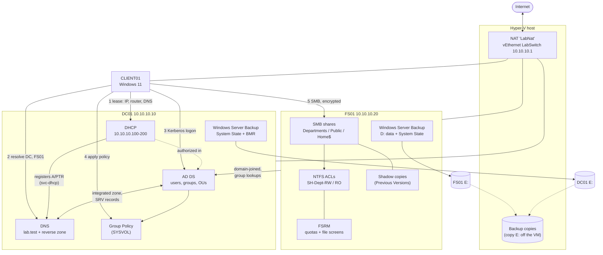
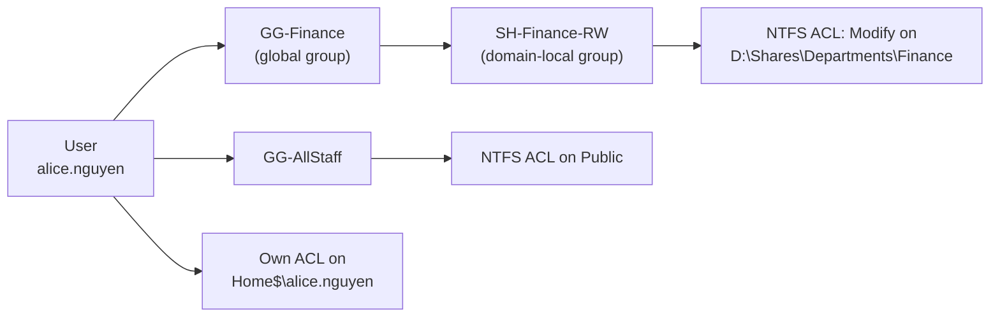
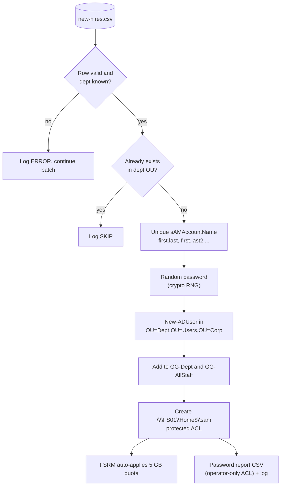
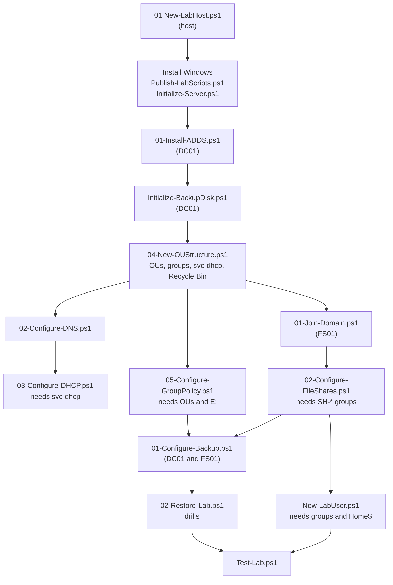

# How the pieces interact

Diagrams are Mermaid, so GitHub renders them inline.

## 1. Runtime: machines and services

## 2. Permissions model (AGDLP)

## 3. User provisioning flow (`New-LabUser.ps1`)

## 4. Build order and dependencies

